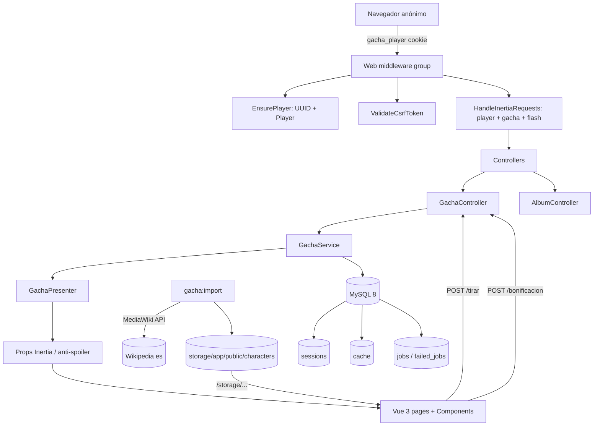

# Arquitectura del proyecto

## Índice

- [Qué hace el sistema](#qué-hace-el-sistema)
- [Stack y versiones](#stack-y-versiones)
- [Estructura y convenciones](#estructura-y-convenciones)
- [Servicios externos](#servicios-externos)
- [Entornos y despliegue](#entornos-y-despliegue)
- [Diagrama de arquitectura](#diagrama-de-arquitectura)
- [Flujos principales](#flujos-principales)
- [Inventario de rutas](#inventario-de-rutas)
- [Supuestos y limitaciones](#supuestos-y-limitaciones)

---

## Qué hace el sistema

Gacha Guaraní es un gachapón web sin registro. Una cookie UUID identifica al jugador, que recibe saldo en “sueldos mínimos (SM)” y obtiene figuras históricas paraguayas con rareza de 1 a 3 estrellas. La colección muestra las 84 figuras; las no descubiertas se ven como siluetas, sin imagen ni biografía.

No hay API REST separada: Laravel renderiza componentes Vue con Inertia y las acciones mutables son `POST` que redirigen (patrón POST/Redirect/GET).

**Carga asumida:** baja/media en un solo servidor (decenas a cientos de jugadores simultáneos). Con miles de tiradas concurrentes o varios nodos, varios hallazgos de concurrencia y crecimiento de tablas deberían revisarse con otro criterio.

---

## Stack y versiones

| Capa | Tecnología | Evidencia |
|---|---|---|
| PHP | `8.3.36` local | `php -v` |
| Laravel | `v13.38.0` | `composer.lock` |
| Inertia Laravel | `v3.5.2` | `composer.lock` |
| Vue | `3.5.44` | `package-lock.json` |
| Inertia Vue | `3.9.1` | `package-lock.json` |
| Vite | `7.3.7` | `package-lock.json` |
| Tailwind CSS | `4.3.3` | `package-lock.json` |
| Axios | `1.20.0` | `package-lock.json` |
| Node local | `v26.13.0` (README pide `20+`) | `node -v`, `README.md:63` |
| Composer | `2.10.2` | `composer --version` |
| MySQL cliente | `8.0.35` | `mysql --version` |
| PHPUnit | `12.5.40` | `composer.lock` |
| Pint / Pail | `1.32.1` / `1.2.7` | `composer.lock` |

Paquetes clave **presentes**: `inertiajs/inertia-laravel`, `laravel/tinker`, `laravel/pail`, `laravel/pint`, `phpunit/phpunit`.

Paquetes **ausentes**: Sanctum, Passport, Spatie, Livewire, Horizon, Pulse, Telescope, Pinia, TypeScript, ESLint y PHPStan/Larastan.

---

## Estructura y convenciones

| Directorio | Responsabilidad |
|---|---|
| `app/Http/Controllers/` | `GachaController` (home, tirada, bonificación) y `AlbumController` (colección) |
| `app/Http/Middleware/` | `EnsurePlayer` (identidad por cookie) y `HandleInertiaRequests` (props compartidas) |
| `app/Services/` | `GachaService`: azar, economía, transacción y bloqueo de fila |
| `app/Support/` | `GachaPresenter` (forma de datos y anti-spoiler) y `Salary` (formato SM) |
| `app/Models/` | `Player`, `Character`, `CollectionEntry`, `Pull` y el scaffold `User` sin uso |
| `app/Console/Commands/` | `ImportCharacters`: importación desde MediaWiki |
| `config/gachapon.php` | Única fuente de verdad del plantel, precios, tasas, `pity`, bonificación y SM |
| `database/migrations/` | Esquema del juego + `sessions`, `cache`, `jobs` |
| `resources/js/pages/` | `Home.vue` y `Album.vue`: solo coordinan datos |
| `resources/js/Components/` | Toda la presentación (máquina, revelado, filtros, temas, etc.) |
| `resources/js/lib/` | `rarity.js` y `themes.js` |
| `resources/js/composables/` | `useDismissableOverlay.js` |
| `resources/css/app.css` | Tokens de color, 9 paletas y animaciones |
| `resources/views/app.blade.php` | Plantilla raíz Inertia con script inicial del tema |
| `tests/` | 10 pruebas de feature y 1 prueba unitaria placeholder |

Convenciones verificadas en `AGENTS.md:5-13`: español en documentación, `.env` no versionado, lógica de UI en `Components/`, tokens CSS en vez de colores fijos, docblock que explica el **por qué**, y migraciones nuevas para cambios de esquema.

---

## Servicios externos

| Servicio | Uso | Detalle |
|---|---|---|
| Wikipedia / MediaWiki | Solo en `php artisan gacha:import` | `API = https://es.wikipedia.org/w/api.php` (`ImportCharacters.php:36`); lotes de 20 títulos y retratos descargados a `storage/app/public/characters/` |
| Google Fonts | Carga en navegador | `app.blade.php:27-29`; solicitud externa a `fonts.googleapis.com` y `fonts.gstatic.com` |
| Correo | `MAIL_MAILER=log` | No se envían correos en el flujo actual |
| Colas | `QUEUE_CONNECTION=database` | No hay clases `Job` ni despacho en el código revisado |
| Storage | Disco `local` + disco `public` | `config/filesystems.php:33-48`; enlace `public/storage` vía `storage:link` |
| Pasarelas de pago | Ninguna | No hay integración de pagos |

---

## Entornos y despliegue

- `.env.example:1-65` define un entorno **local**: `APP_ENV=local`, `APP_DEBUG=true`, `APP_KEY=` vacío, `APP_URL=http://localhost`, MySQL como `root`.
- No hay `.env.production.example`, Dockerfile, `docker-compose`, configuración de Nginx, `.github/` ni `.nvmrc` en `git ls-files`.
- El servidor web detectable es Apache: `public/.htaccess:1-25` con rewrite y `Options -Indexes`. No agrega cabeceras de seguridad.
- `public/index.php:14-20` usa `public/` como único front controller; el resto del proyecto queda fuera del document root.
- `composer.json:43-46` define `composer run dev` con `php artisan serve`, `queue:listen --tries=1 --timeout=0`, Pail y Vite. Es un script de desarrollo, no de producción.
- Los artefactos generados están ignorados: `.gitignore:15-21` excluye `node_modules`, `public/build`, `public/storage`, `vendor` y `storage/*.key`.

**NO VERIFICADO:** servidor real, TLS, PHP-FPM, `php.ini`, WAF/CDN, rotación de logs, permisos de `storage/` y `bootstrap/cache/`, backups.

---

## Diagrama de arquitectura

---

## Flujos principales

### 1. Tirada simple o múltiple

1. `PullControls.vue:25-29` emite `pull(count)`; `Home.vue:47-60` bloquea con `pulling` y hace `router.post('/tirar', { count })`.
2. `GachaController::pull()` valida `count ∈ {1, multi_pull}` (`GachaController.php:77-79`).
3. `GachaService::pull()` abre transacción, vuelve a leer al jugador con `lockForUpdate()` (`GachaService.php:45-47`), cobra, sortea con `random_int()` y `pity`, registra copias e historial (`GachaService.php:71-119`).
4. El controlador redirige con `with('pull', $result)` (`GachaController.php:83-85`).
5. `Home.vue:39-45` observa `page.props.lastPull` y abre `PullReveal.vue`.
6. «Tirar de vuelta» mantiene el overlay abierto y repite la misma cantidad (`Home.vue:72-78`).

### 2. Bonificación

1. `BonusClaim.vue:21-34` calcula la cuenta regresiva desde `player.bonus_ready_at`.
2. `Home.vue:64-66` hace `POST /bonificacion`.
3. `GachaController::bonus()` (`GachaController.php:97-115`) abre transacción, bloquea la fila, vuelve a comprobar `canClaimBonus()` y acredita.
4. `ToastNotice.vue:22-36` muestra el `flash.message`.

### 3. Colección

1. `AlbumController::index()` (`AlbumController.php:27-42`) carga entradas con `keyBy('character_id')` y mapea el catálogo con `toCard()`.
2. `Character::toCard()` (`Character.php:81-98`) oculta `image` y `extract` si no hay entrada de colección.
3. `Album.vue:53-71` filtra en cliente por rareza, búsqueda y “Solo descubiertos”.

### 4. Importación desde Wikipedia

1. `ImportCharacters::handle()` lee `config('gachapon.roster')` y aplica filtros (`--only`, `--missing`, `--no-images`, `--fresh`).
2. `fetchPages()` consulta MediaWiki con reintentos (`ImportCharacters.php:229-287`).
3. `downloadImage()` y `storeImage()` descargan y guardan el retrato (`ImportCharacters.php:315-372`).
4. `updateOrCreate()` sincroniza la ficha en `characters` (`ImportCharacters.php:145-158`).

---

## Inventario de rutas

Obtenido con `php artisan route:list --json --no-ansi` tras instalar dependencias, y contrastado con `routes/web.php` y `bootstrap/app.php`.

| Método | URI | Middleware | Acción |
|---|---|---|---|
| GET/HEAD | `/` | web + EnsurePlayer + HandleInertiaRequests | `GachaController@index` |
| POST | `/tirar` | web + EnsurePlayer + HandleInertiaRequests + CSRF | `GachaController@pull` |
| POST | `/bonificacion` | web + EnsurePlayer + HandleInertiaRequests + CSRF | `GachaController@bonus` |
| GET/HEAD | `/coleccion` | web + EnsurePlayer + HandleInertiaRequests | `AlbumController@index` |
| GET/HEAD | `/up` | health (framework) | `HealthCheck` |
| GET/HEAD | `_inertia/devtools/entries` | web + DevTools | `EntriesController@index` |
| GET/HEAD | `_inertia/devtools/entries/{id}` | web + DevTools | `EntriesController@show` |
| GET/HEAD | `storage/{path}` | ninguno (framework) | `ServeFile` |
| PUT | `storage/{path}` | ninguno (framework) | `ReceiveFile` |

Las rutas de DevTools pertenecen a Inertia y solo se registran en el entorno local auditado; en producción deben revisarse. Las rutas `storage/{path}` las registra `FilesystemServiceProvider.php:111-125`: el `GET` sirve archivos del disco `local` y el `PUT` exige `?upload=true` con firma relativa válida (`ReceiveFile.php:28-30,45-47`), por lo que **no** es un upload abierto. No hay rutas `auth`, API, `api/*`, webhooks ni versionado.

---

## Supuestos y limitaciones

- La carga baja/media es un supuesto confirmado por el usuario, no una medición.
- `route:list`, `about`, `test` (sobre MySQL) y `build` sí se ejecutaron en la re-auditoría; el inventario de rutas ya no es estático.
- Se verificó MySQL **8.0.35 en vivo** en el entorno local; la versión y topología de producción siguen siendo `NO VERIFICADO`.
- El diagrama refleja el código versionado y el entorno local, no una topología de producción real.
